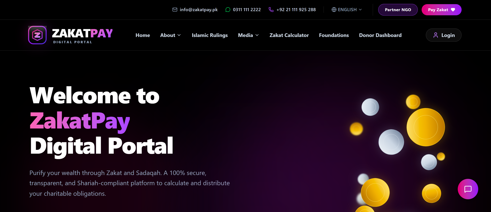
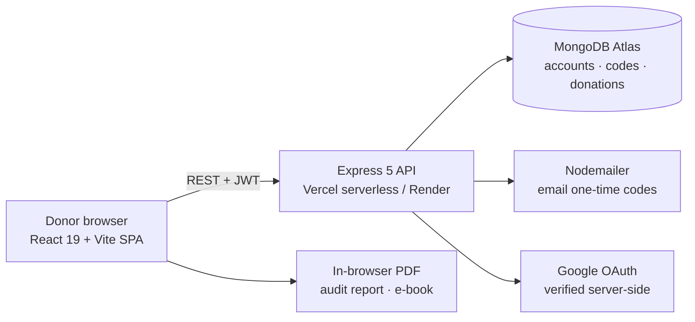

# ZakatPay Portal

A zakat and donation portal for Pakistan. ZakatPay helps people work out the
zakat they owe, learn the rulings behind it, and find a trusted charity to give
to, all in one responsive web experience.

[**Open the live portal**](https://zakatpay.twinstackstudio.com) ·
[**Work with TwinStack Studio**](https://twinstackstudio.com/contact)

> **Portfolio demo:** Checkout is simulated. No payment is processed and no card
> details are sent or stored. The charities listed are shown for demonstration
> only; this project is not affiliated with or endorsed by any of them.

## What the product delivers

### For donors

- Zakat calculator covering cash, bank balances, gold, silver, investments and business stock, checked against the silver nisab
- Directory of Pakistani charities with profiles, causes and a guided donate and checkout flow
- Sign-up and sign-in with email one-time codes, passwords or Google
- Personal dashboard and donation ledger for signed-in users
- Downloadable PDF documents, including an audit report and an e-book, generated in the browser

### Learning and engagement

- Islamic rulings, blogs, news and video library
- Built-in chatbot with quick replies for common zakat questions
- Animated hero with floating gold and silver coins, and smooth page transitions, fully responsive on mobile and tablet

### Engineering highlights

- Express API with MongoDB for accounts, one-time codes and donation records
- JWT sessions; every donation route reads the account from the token, so users can only access their own records
- Google sign-in verified server-side with Google rather than trusting the client
- Configurable CORS allow-list, request size limits and a health check that reports database status
- Serverless-ready API entry point for Vercel, plus a Render blueprint

## Technology

| Layer | Stack |
| --- | --- |
| Frontend | React 19, React Router 7, Vite, Tailwind CSS 4, Framer Motion |
| Backend | Node.js, Express 5, Mongoose |
| Data | MongoDB Atlas |
| Authentication | JWT, bcrypt, email one-time codes via Nodemailer, Google OAuth |
| Hosting | Vercel (frontend), Vercel serverless or Render (API) |

## Architecture

## Source code

This is the public showcase. The source code is kept in a private repository. Try the live demo above, and [contact TwinStack Studio](https://twinstackstudio.com/contact) for a walkthrough or a similar project.

## Built by TwinStack Studio

TwinStack Studio builds full-stack websites, web applications, dashboards,
portals, automation, and AI-powered products.

[GitHub](https://github.com/twinstack-studio) ·
[Website](https://twinstackstudio.com) ·
[Email](mailto:hello@twinstackstudio.com)

© 2026 TwinStack Studio. All rights reserved. See [LICENSE](./LICENSE).
